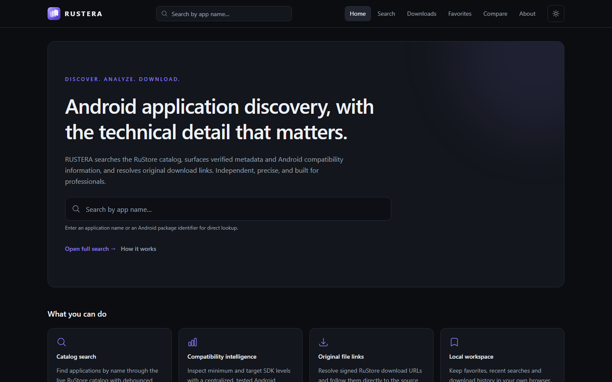
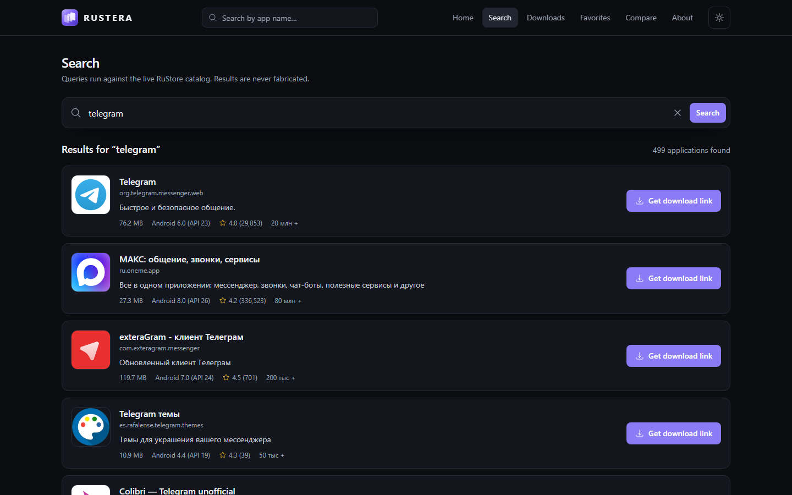
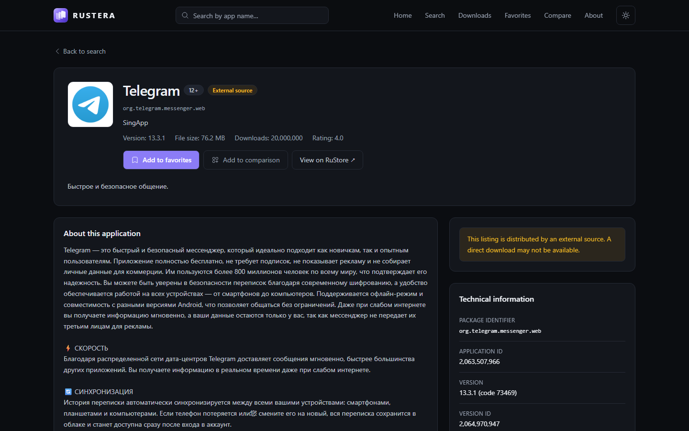

# RUSTERA

**Discover. Analyze. Download.**

RUSTERA is a web application for discovering Android applications in the RuStore catalog, inspecting verified technical metadata, and resolving original download links. It is an independent project — not affiliated with, endorsed by, or connected to RuStore or VK.

The site is a fully static Next.js export deployed to GitHub Pages. The browser talks directly to the CORS-enabled RuStore API — no backend is involved.

## Features

- **Live catalog search** — debounced, keyboard-friendly search with recent-search suggestions, pagination, loading skeletons, explicit empty and error states, and no fabricated results.
- **Package lookup** — detail pages addressed by Android package identifier (`/app/?p=<packageName>`), so every package works from a static host.
- **Application details** — descriptions, screenshots, developer, version, release dates, ratings, age rating, category and source URL, using only fields actually returned upstream.
- **Android compatibility intelligence** — centralized, tested API-level → Android version mapping, with honest handling of unknown values and an explicit note that device compatibility cannot be guaranteed.
- **Original-file downloads** — resolves signed RuStore URLs in the browser, validates every URL against an HTTPS host allow-list, and links straight to the original CDN file. No repackaging, no renaming, no proxying.
- **Download history** — local-only metadata history with search, removal, clearing and detail links. Signed URLs are never stored.
- **Favorites and comparison** — local bookmarks and a side-by-side technical comparison of up to three apps.
- **Premium UI** — dark-first semantic design tokens, light theme, responsive layout, Heroicons throughout, reduced-motion support and accessible markup.

## Screenshots

| Home | Search | Application details |
| --- | --- | --- |
|  |  |  |

## Technology stack

| Layer | Technology |
| --- | --- |
| Framework | Next.js 16 (App Router, static export), React 19 |
| Language | TypeScript 5 (strict, `noUncheckedIndexedAccess`) |
| Styling | Tailwind CSS 4 with semantic CSS tokens |
| Icons | `@heroicons/react` exclusively |
| Validation | Zod 4 |
| Testing | Vitest 5, Playwright 1 |
| Tooling | ESLint 10, Prettier 3, npm |

## Requirements

- Node.js 20.9+ (verified on Node 24)
- npm 10+
- Network access to `backapi.rustore.ru` for live usage (tests mock the upstream)

## Installation

```bash
npm install
npm run dev
```

Open <http://localhost:3000>.

## Environment configuration

Variables are documented in `.env.example`:

| Variable | Default | Purpose |
| --- | --- | --- |
| `NEXT_PUBLIC_RUSTORE_VERSION_CODE` | `1105001` | Compatibility header value observed in the reference client; not a secret |
| `NEXT_PUBLIC_SITE_URL` | `https://modeusweb.github.io/rustera` | Canonical URL, Open Graph, robots and sitemap base |

No secrets are required. Do not put credentials into `NEXT_PUBLIC_*` variables.

## Commands

```bash
npm run dev              # development server
npm run build            # production build (static export)
npm run lint             # ESLint
npm run typecheck        # strict TypeScript check
npm run format           # Prettier
npm run test             # unit tests (Vitest)
npm run test:e2e         # Playwright end-to-end tests
npm run verify           # lint + typecheck + test + build
npm run audit:prod       # production dependency audit
```

## Testing

Unit tests cover Android SDK mapping, package/query validation, URL validation, normalizers and error mapping. Playwright covers navigation, search, details, downloads, errors, favorites, history, themes and mobile navigation with mocked upstream responses. Ordinary CI never depends on live RuStore availability.

## Deployment

Pushes to `main` build the static export (`GITHUB_PAGES=true` sets `basePath: /rustera`) and publish `out/` to GitHub Pages via `actions/deploy-pages`. See [docs/DEPLOYMENT.md](docs/DEPLOYMENT.md).

## Known limitations

- RuStore's catalog API is undocumented and may change or become unreachable without notice.
- The upstream API must allow cross-origin requests from the site origin; if it stops, the client will surface a friendly error.
- Search requires a non-empty query; verified upstream sorting/category filters are unavailable and therefore not rendered.
- Supported CPU architectures are not published by the inspected API.
- Most downloads are ZIP archives containing split APK files; RUSTERA never renames them to `.apk`.
- Signed URLs expire. History stores only metadata.
- Some listings use external sources and cannot be downloaded directly; these are labeled in the UI.
- The upstream service is regionally restricted and may block some networks.

Full findings, with verification dates, are in [docs/RUSTORE-INTEGRATION.md](docs/RUSTORE-INTEGRATION.md).

## Documentation

- [Architecture](docs/ARCHITECTURE.md)
- [RuStore integration](docs/RUSTORE-INTEGRATION.md)
- [Deployment](docs/DEPLOYMENT.md)
- [Security](docs/SECURITY.md)
- [Contributing](CONTRIBUTING.md)

## License

No license is published. All rights reserved unless explicitly stated otherwise.
